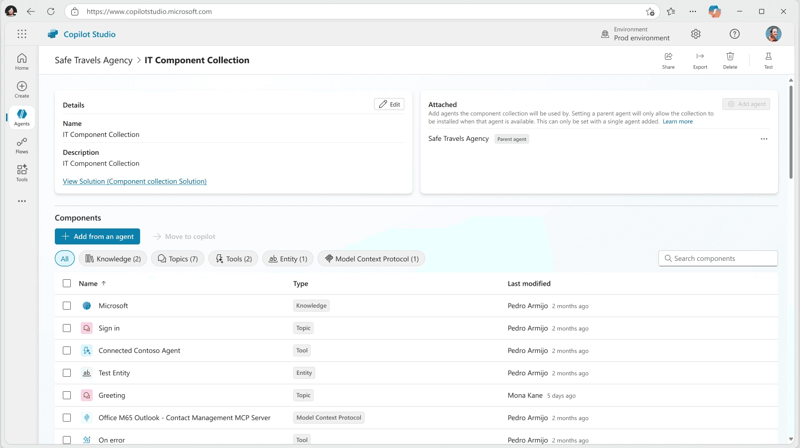
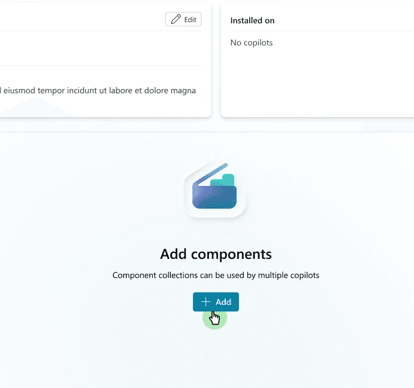
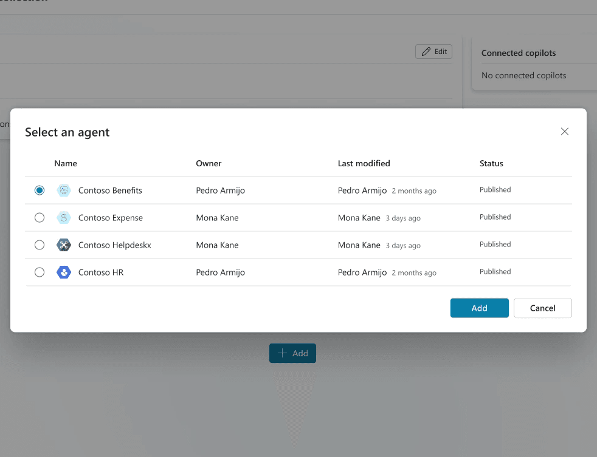
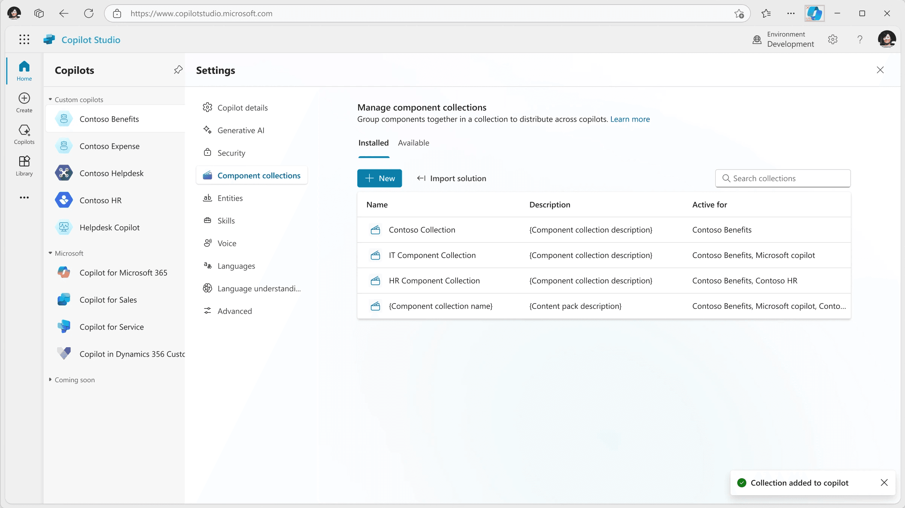
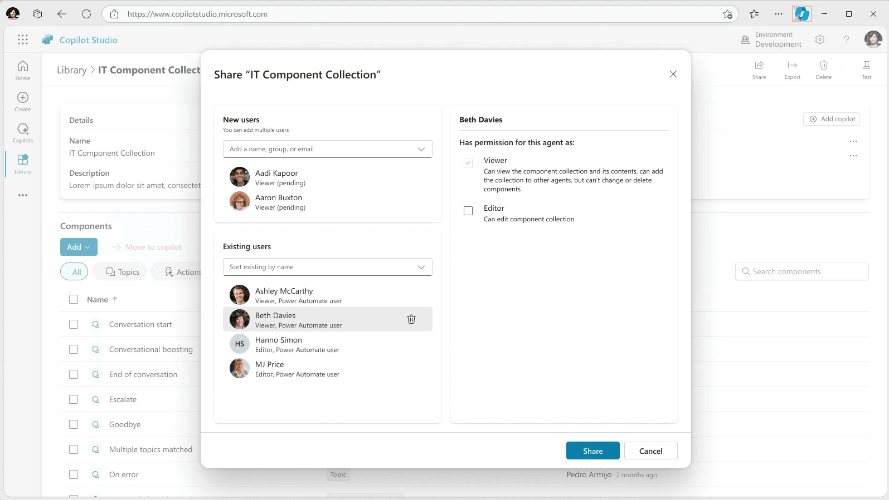
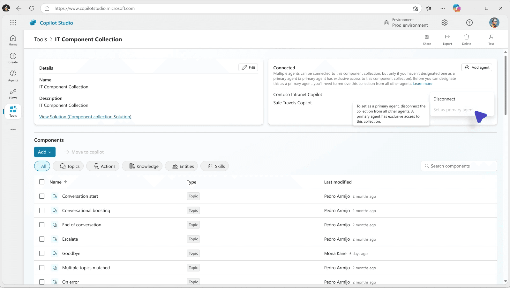

import Stats from "../../components/content/Stats.astro";
import Facts from "../../components/content/Facts.astro";
import Gallery from "../../components/content/Gallery.astro";
import Quote from "../../components/content/Quote.astro";
import LogoGrid from "../../components/content/LogoGrid.astro";

Component Collections is a feature in Copilot Studio that allows makers to group and reuse bot components, including topics, actions, entities, and knowledge, across multiple agents and environments. This modular approach streamlines bot development, supports Application Lifecycle Management, and enables scalable content sharing, including the ability for ISVs to package and distribute bot content commercially.

I was the sole designer on this feature from discovery through GA launch, owning the end-to-end design direction across every stage of the process.

## Overview

Component Collections is a feature in Copilot Studio that allows makers to group and reuse bot components - such as topics, actions, entities, and knowledge - across multiple agents and environments. This modular approach streamlines bot development, supports Application Lifecycle Management (ALM), and enables scalable content sharing, including monetization by ISVs.

## Background + Motivation

The feature came directly from customers. Enterprise clients across industries had been pushing back on the limitations of existing export and import mechanisms, which required full bot redeployments for even minor updates. This created duplicated effort, increased the risk of regressions, and made collaboration across large teams unnecessarily difficult.

It quickly became the number two most-requested feature in the Copilot Studio backlog, with several enterprise customers identifying it as a blocker for adoption. The business case was strong, but it took sustained advocacy to get the feature prioritized. Because the workarounds were not obvious from the outside, even internal stakeholders needed convincing that this was as urgent as customers were saying. Getting alignment required me to deeply understand not just what customers were asking for, but why existing solutions were falling short and what the cost of inaction actually was.

## The Challenge

The core problem was deceptively simple to describe but genuinely complex to solve: makers were rebuilding the same components over and over across different agents and environments, with no way to share, update, or distribute that work at scale.

For enterprise organizations managing dozens or hundreds of agents, this was not a minor inconvenience. It was a meaningful drag on velocity, a source of inconsistency across their deployments, and a ceiling on what they could realistically build and maintain on the platform.

<Gallery>

</Gallery>

## Process

**Discovery + Research:** I applied the Jobs to be Done framework to map the needs of both creators and consumers of component collections. This helped move the team beyond feature requests and toward a clearer understanding of what makers were actually trying to accomplish and why the current product was falling short. I identified entry points at both the agent and environment level, mapped use cases for internal reuse, external publishing, and modular bot construction, and used these findings to establish the design direction.

I partnered closely with our dedicated researcher to run usability studies at multiple stages of the design process. I helped set the goals and priorities for each round of testing, and the findings shaped how we handled key decisions around permissions, access levels, and the way collections were surfaced and managed within the product.

**Information Architecture**:  
Following the Build conference, I reassessed the information architecture of Copilot Studio to determine the most intuitive home for the feature. This led to a redesign of the Copilot Studio Library to accommodate shared elements, clarification of repository roles across Library, Catalog, and AppSource, and the removal of redundant entry points that were adding confusion rather than flexibility.

**Cross-Functional Collaboration:**  
This feature touched multiple teams and required sustained coordination across engineering, the Dataverse team, PMs across Copilot Studio and Power Platform, and design leadership. I worked through triad reviews, peer critiques, and experience reviews throughout the process, and drove alignment on technical constraints, implementation feasibility, and the consistency of patterns across the broader platform.

**Iteration + Validation:**  
Designs went through multiple rounds of iteration based on feedback from design leadership, engineering partners, and product stakeholders. The feature was bug-bashed and refined before its public preview launch at MPPC.

<Quote by="Product Manager, Copilot Studio">
  We are expecting this feature to significantly increase Monthly Average Users/Revenue given it’s
  the second most requested feature in our backlog from customers
</Quote>

## Results

The adoption numbers after launch made a strong case on their own.

During the preview period, over 300,000 agents used Component Collections, with more than 4,000 monthly active users, demonstrating demand that matched what customers had been telling us throughout the process.

By November 2025, approximately 12.5 percent of all agents on the platform, roughly 1 in 8, were using a Component Collection. That figure was called out internally as a significant milestone and became a recurring metric in leadership reviews.

These figures are from the public preview period. The feature has since reached general availability, and GA usage data isn’t available to me.

<Gallery>

</Gallery>

## Conclusion

Component Collections reinforced something I think is easy to underestimate as a designer: just because a problem is not immediately visible does not mean it is not causing serious damage.

This feature was genuinely difficult to advocate for early on because there were surface-level workarounds that made it seem less urgent than it was. Getting alignment required me to fully understand what customers were trying to do, why the existing options were not actually solving the problem, and what the real cost was of continuing to leave it unaddressed. That meant going deeper than the feature request itself and building a clear picture of the underlying need before I could make the case for the design direction.

The usage numbers after launch confirmed what customers had been saying all along. As designers, being willing to acknowledge what we do not yet understand, and doing the work to close that gap before jumping to solutions, is one of the most important things we can bring to a product team.
