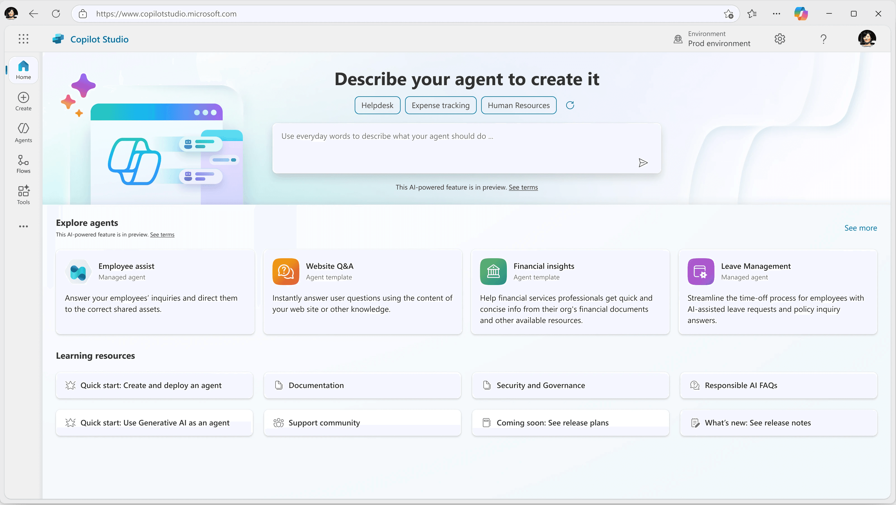
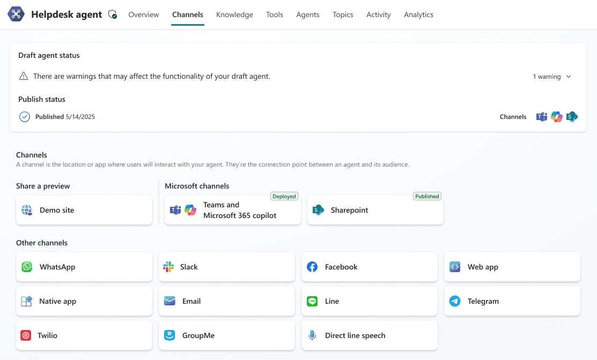
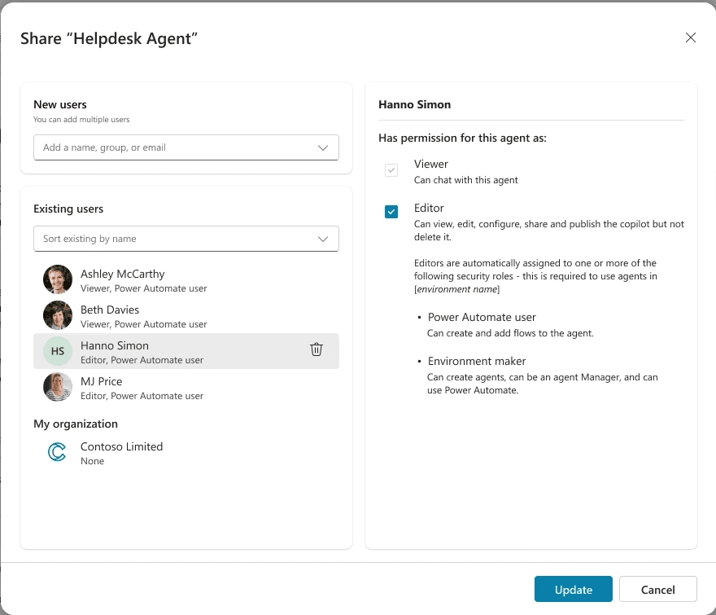
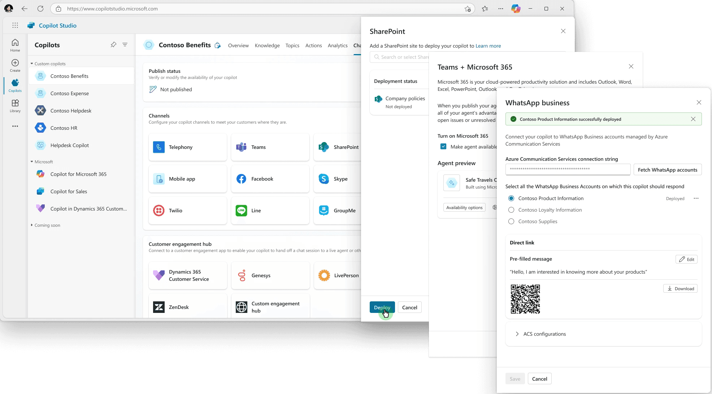
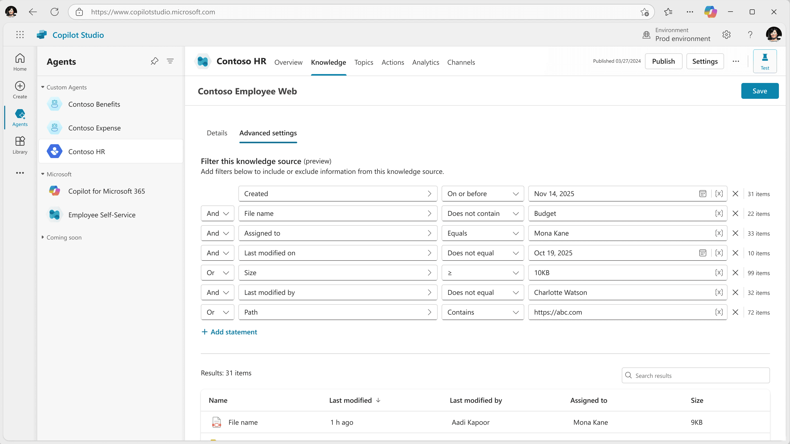

import Stats from "../../components/content/Stats.astro";
import Facts from "../../components/content/Facts.astro";
import Gallery from "../../components/content/Gallery.astro";
import Quote from "../../components/content/Quote.astro";
import LogoGrid from "../../components/content/LogoGrid.astro";

Copilot Studio is Microsoft's platform for building, configuring, and deploying AI agents across enterprise environments. It serves a broad range of makers, from professional developers to business users with no coding background, giving organizations the tools to create agents grounded in their own data and deployed across the channels their users work in every day. The platform is used by more than 230,000 organizations, including 90% of the Fortune 500, and sits at the center of Microsoft’s enterprise AI strategy.

I am a product designer on one of several small teams within the broader Copilot Studio design organization, which spans between 15 and 25 designers across the full product. Within my team of four designers and a dedicated researcher, I own design across a significant portion of the product surface. For over three years I have held design ownership across seven major pillars: Publishing, Sharing and Channels; Knowledge and Grounding; Agent Configuration; Activity, Diagnostics and Evals; Governance and Security; Reusable Components; and Agent Readiness and Status. My work spans everything from 0 to 1 feature design to iterative improvements driven by research, customer feedback, and product strategy.

<Facts
  title="About Copilot Studio"
  items={[
    { label: "Headquarters", value: "Redmond, WA, USA" },
    { label: "Founded", value: "2023" },
    { label: "Product", value: "Low-code generative AI agent creation platform" },
    { label: "Revenue", value: "$270 billion (Microsoft, 2025)" },
    { label: "Team size", value: "228K+ (Microsoft)" },
  ]}
/>

## Challenge

Enterprise makers building on Copilot Studio were running into a consistent set of problems, most of them rooted in the same underlying issue: the product was powerful, but the experience of understanding, configuring, and deploying an agent was far more opaque than it needed to be.

The problems showed up differently depending on where a maker was in their journey. Makers connecting knowledge sources, such as SharePoint sites, files, Dataverse data, and websites, struggled to understand why their agent was not producing the expected answers, often because grounding had not been configured correctly and the product was not surfacing enough guidance to help them fix it. Makers configuring channels and publishing faced a web of confusion: they were unclear on their agent's publish status, unclear on which channels were available and why others were not, and unclear on the relationship between publishing and channels themselves. Does publishing make an agent live on a channel? Does a channel need to be added before publishing? What does it mean for an agent to be shared versus deployed? These were not edge case questions. They were the questions most makers had, and the product was not answering them.

Makers trying to understand how their agent was performing after deployment had limited visibility and limited ability to troubleshoot effectively. History existed in the product, but not in the places or forms that actually helped makers diagnose problems. Governance and security settings created additional confusion, particularly when admin policies like data loss prevention silently restricted what makers could do without clear explanation.

Underlying all of this was a publish rate problem. A significant percentage of makers were building agents but never successfully deploying them. The friction in the publishing and channel experience was a primary driver, and raising that number became one of the most important outcomes the team was working toward.

<Stats
  items={[
    { value: "230k+", label: "Organizations that have used Copilot Studio (Microsoft, Apr 2025)" },
    { value: "90%", label: "Of the Fortune 500 have used it (Microsoft, Apr 2025)" },
    {
      value: "1M+",
      label:
        "Custom agents created in one quarter, up 130% (SharePoint and Copilot Studio, Apr 2025)",
    },
  ]}
/>

<LogoGrid title="Customers">

</LogoGrid>

## Process

**Research and validation:**  
My process across all of these areas was grounded in close partnership with the research team. We ran usability studies with enterprise makers, reviewed customer feedback and support signals, and regularly dogfooded concepts with internal teams to validate and refine experiences before they reached customers. Content design was a consistent collaborator, particularly in areas where the language itself was part of the problem: terminology around publishing, channel status, and agent readiness was frequently misunderstood, and getting the words right was as important as getting the interactions right.

<Gallery>

</Gallery>

**Publishing, Sharing and Channels**:  
The availability and distribution of an agent, making it live and accessible to the right people in the right places, was the area I spent the most sustained time on and have returned to multiple times as the product has evolved. The core problem was that makers could not build an accurate mental model of how publishing and channels related to each other, what their agent's status was at any given moment, and what actions they needed to take to make their agent available.

I worked to untangle this by clarifying the relationship between publishing and channels in the UI, surfacing publish status and channel status in more transparent and actionable ways, and redesigning the configuration experience for individual channels to reduce ambiguity at every decision point. Sharing added another layer: makers needed to understand not just how to share an agent, but what sharing actually enabled, who could do what, and how sharing related to the other ways of making an agent available, including deploying to the Teams app store, generating a shareable link, and configuring channel-specific access.

**Knowledge and Grounding:**  
I owned design for the knowledge and grounding area of Copilot Studio, which covers how makers connect their agent to the information sources it needs to answer questions accurately, including SharePoint sites, uploaded files, Dataverse data, public websites, and other content. The primary problem was that makers did not always understand how to configure grounding correctly, and when their agent produced unexpected or inaccurate answers, they had little guidance to help them diagnose and fix it. My work focused on making the connection and configuration process clearer and surfacing better feedback when something was not working as expected.

**Agent Configuration:**  
Agent configuration covers the tools and protocols makers use to extend and customize how their agent works, including model selection, agent identity, MCP integrations, and agent-to-agent communication. MCP in particular introduced a new kind of complexity: it is a protocol-level capability that makers needed to be able to leverage without necessarily understanding the underlying technical details. The challenge here was similar to channels: a lot of capability packed into an experience that was not yet giving makers the clarity or confidence they needed to use it effectively.

**Activity, Diagnostics and Evals:**  
Once an agent is deployed, makers need to understand how it is performing and be able to troubleshoot when something goes wrong. The product had history and activity data, but it was not surfaced in the ways or places that actually helped makers answer the questions they had. My work in this area focused on giving makers better visibility into past agent actions and conversations, and making it easier to identify and resolve problems without having to piece together information from multiple disconnected places.

**Agent Readiness and Status:**  
Agent readiness and status is directly connected to the publishing and channel problem. Before a maker publishes, they need to know whether their agent is actually ready: which channels have been configured, what the publish status is across each of them, and whether there are any issues that need to be resolved first. The lack of transparency here was one of the reasons makers were getting stuck before deployment. My work focused on giving makers a clear, accurate picture of where their agent stood and what they needed to do next.

**Governance and Security:**  
I also contributed to governance and security work, including design support for deployment pipelines and ALM work in collaboration with a team outside of Copilot Studio whose feature surfaces in the Copilot space. A recurring theme in this area was that admin-level policies, such as data loss prevention settings, were silently restricting what makers could do without surfacing clear explanations. Makers would encounter a blocked action with no understanding of why, which eroded trust in the product and created unnecessary support burden.

**Reusable Components:**  
Component Collections is covered in depth in its own case study. It was the number two most-requested feature in the Copilot Studio backlog and represented one of the most complex 0 to 1 design challenges I took on during my time on the team.

## Results

For over three years on Copilot Studio I have been the design owner for a significant portion of the product surface, working on features that are used by enterprise makers across thousands of organizations globally. The work has ranged from foundational UX improvements to net-new capability design, consistently aimed at reducing friction, increasing clarity, and helping more makers successfully build and deploy agents.

The publish rate problem was one of the clearest indicators of whether the work was landing. A meaningful increase in the percentage of makers successfully deploying their agents was a goal shared across product, engineering, and design, and improving the publishing and channel experience was a direct input to that outcome.

I am currently in an active design phase for the next iteration of publishing, channels, and historical activity, work that builds on everything learned from the research and iteration cycles described above.

## Conclusion

Working on Copilot Studio has taught me what it actually means to design at the center of a company's strategic priorities. When a product is this visible and this important to the organization, the design work does not happen in a vacuum. It requires a deep understanding of the product's technical architecture, the ecosystem it lives in, the enterprise customers it serves, and the organizational dynamics that shape what gets built and when.

It has also reinforced for me that breadth and depth are not opposites. Owning design across a product with this much surface area requires being able to move fluidly between high-level strategic thinking and detailed interaction design, sometimes in the same week. The connective tissue between features, the way a maker's mental model spans publishing, channels, knowledge, and status all at once, is just as much a design problem as any individual screen.

The work is not finished. But the foundation is there, and I am proud of the role I have played in shaping it.
