import Stats from "../../components/content/Stats.astro";
import Facts from "../../components/content/Facts.astro";
import Gallery from "../../components/content/Gallery.astro";
import Quote from "../../components/content/Quote.astro";
import LogoGrid from "../../components/content/LogoGrid.astro";

Nuance Mix is an enterprise conversational AI platform built on speech and NLU technology trusted by 1,500+ leading brands, including 75% of the Fortune 100, across healthcare, retail, and customer service. The platform allows both technical and non-technical users to build, train, and deploy voice and chat experiences, from defining intents and dialog flows to publishing finished bots across channels.

As the sole designer on this feature, I owned the end-to-end design direction for versioning in Mix, from initial problem framing through high-fidelity handoff. I worked in close partnership with a principal engineer who served as my technical counterpart, helping me understand the constraints and architecture of what we were building. The design decisions, the interaction model, and the product direction were mine to drive.

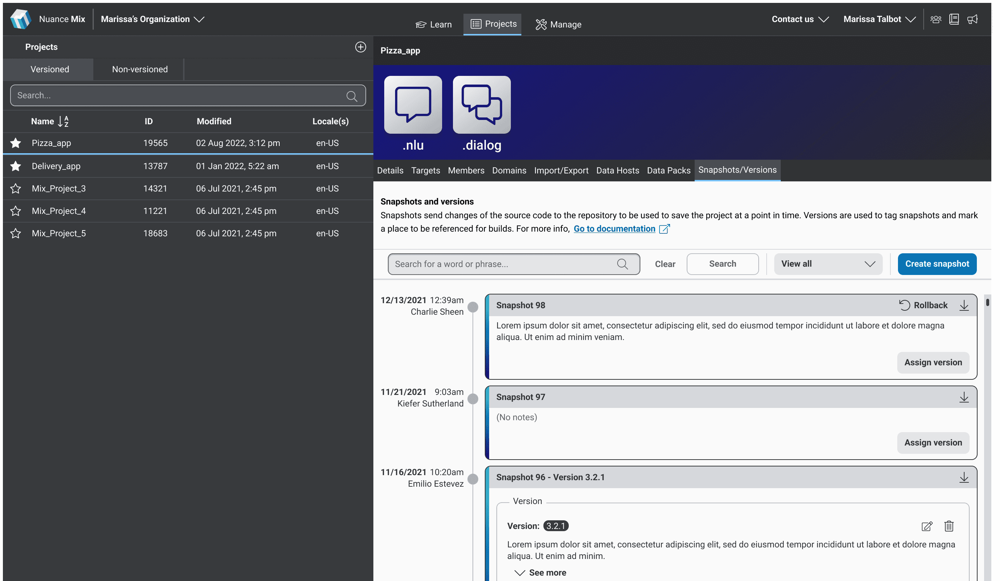

## Challenge

Enterprise teams building on Mix were running into a problem familiar to anyone who has shipped a product: things go wrong after deployment, and recovering from those mistakes was harder than it needed to be. Users wanted an easier way to roll back to a known good state after a bad deploy. They wanted to track the history of their bot over time, understand what changed and when, and restore previous states without manual workarounds. For teams with multiple contributors working on the same project, the risk of overwriting each other's work was a constant friction point.

The challenge was compounded by the nature of the product. Most versioning systems live in code environments where the mental model of branches, commits, and diffs is second nature to developers. Mix served a much broader audience. Business users, content designers, and conversation architects were building bots alongside technical users, and they had no frame of reference for the conventions of code-based version control.

The goal was clear: bring the safety and confidence of versioning to Mix in a way that felt native to a visual product builder, not a code editor.

<Gallery>

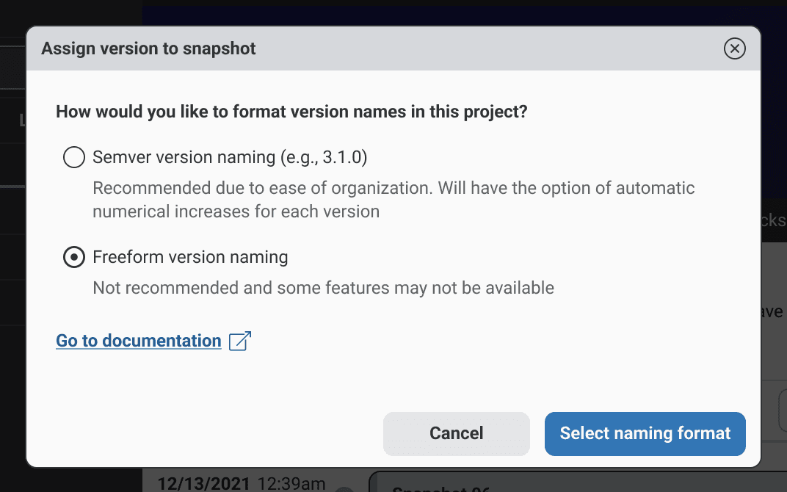
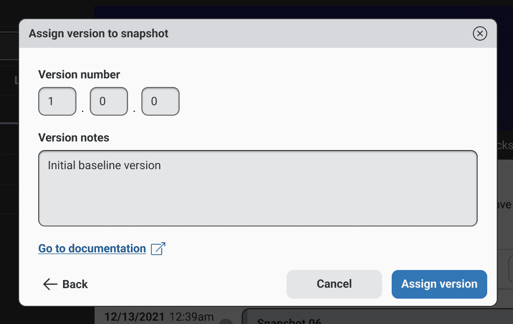

</Gallery>

## Process

**Research & Competitive Analysis:**  
To get my footing, I drove my own competitive analysis across a wide range of products that had solved versioning in some form, including Figma, Webflow, various CMS platforms, and developer tools like GitHub and GitLab. The developer tools were instructive but not directly transferable. They assume a user who thinks in commits and branches. Mix needed something that could be understood immediately by someone who had never touched a terminal.

**Landing on the timeline model**  
The timeline emerged early as the right pattern. It is a universally understood metaphor. Everyone knows how to read a timeline, and it immediately communicates the core concept: your bot has a history and you can move through it. I explored an alternative approach using a flat list of versions and snapshots, but that format lost something important: the sense of time passing, of distance between states. The timeline made the relationship between snapshots and versions intuitive in a way a list could not.

<Gallery>

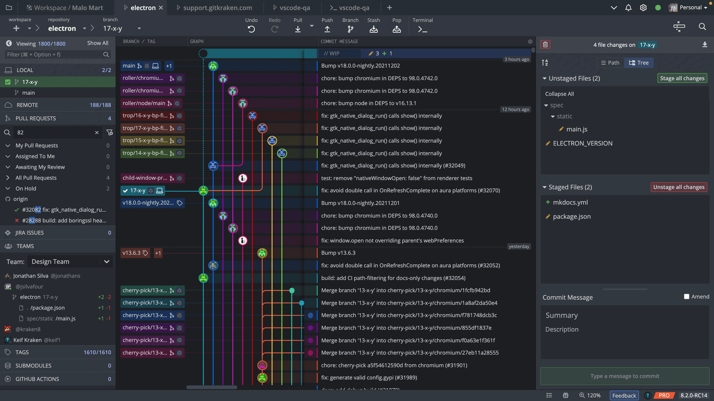
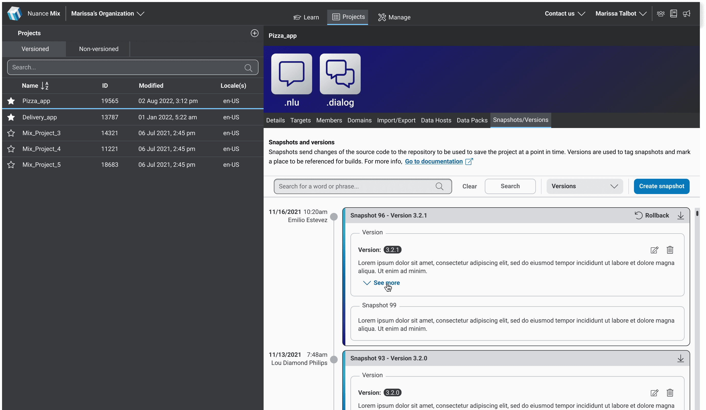

</Gallery>

Working closely with my principal engineer counterpart, I developed a clear picture of what was technically feasible and used those constraints as design inputs rather than blockers. The core model worked like this: users manually created snapshots at meaningful points as they worked on their bot. These were lightweight save states that appeared as markers on the timeline and could be annotated with notes to give collaborators context about what had changed. From the three most recent snapshots, a user could create a named version: a more deliberate, referenceable save state they could roll back to at any time. For older snapshots that could not be directly restored due to technical constraints, any snapshot could be downloaded and re-uploaded as a new project. Understanding the technical limitation clearly enough to design a user-facing solution around it was one of the more satisfying problems I solved on this feature.

<Gallery>

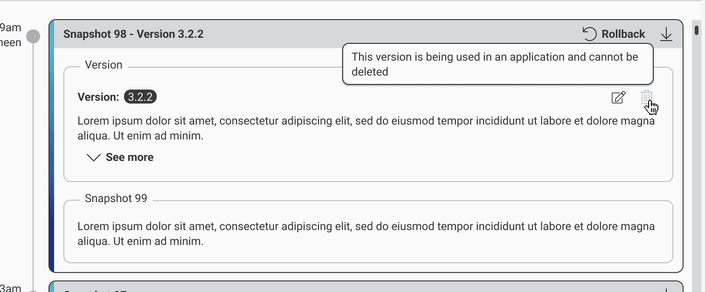
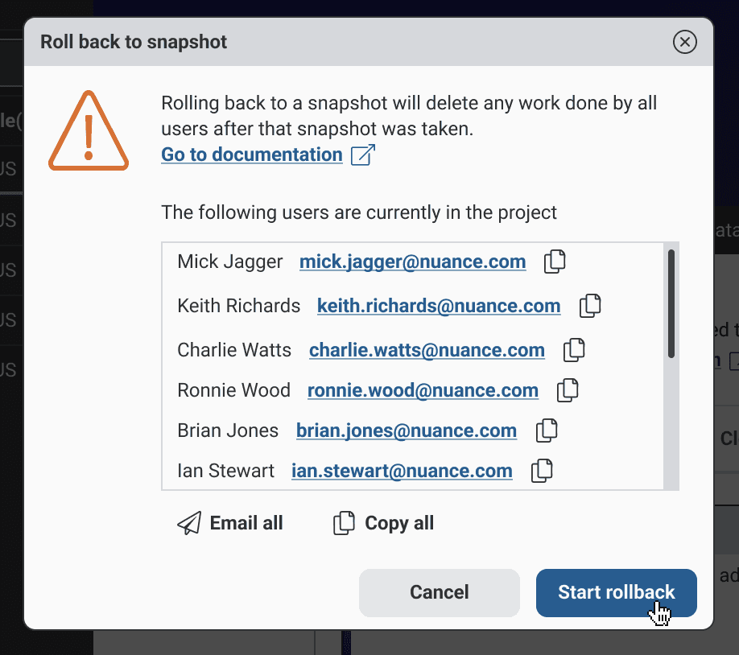
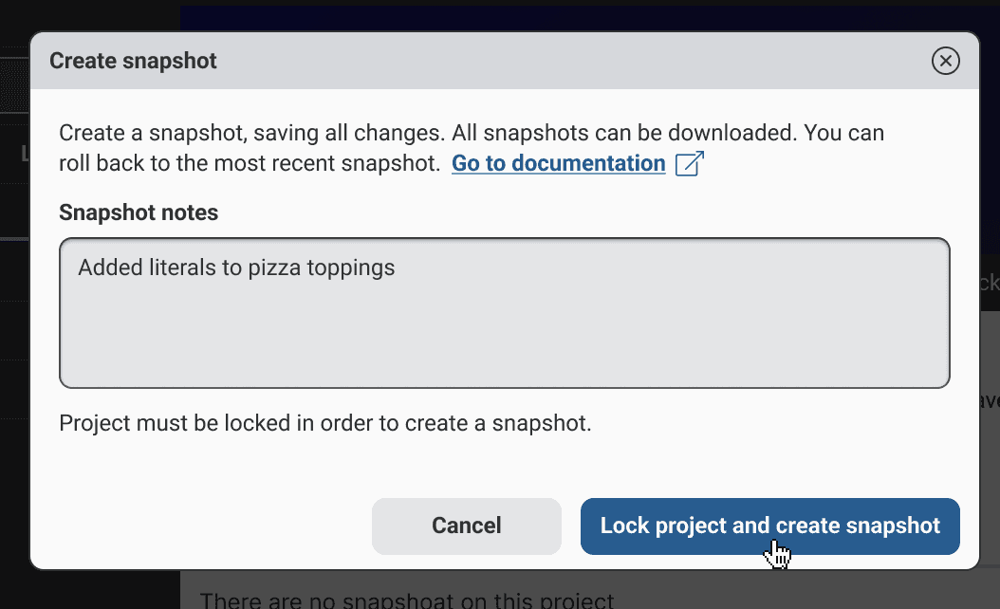

</Gallery>

**Multi-user considerations:**  
The system also accounted for multi-contributor projects, where versioning applied to the bot as a whole rather than individual user sessions, keeping shared environments stable without adding friction for collaborators.

**Max and the loading states:**  
A separate design challenge ran alongside this work that became one of my most visible contributions to Mix. Our design manager challenged the team to create a mascot for the platform. I designed Max, a robot character that won unanimous approval and rolled out product-wide, appearing in banners, the home screen, and the loading states that users would encounter throughout the versioning flow. The work went beyond a single illustration: I developed multiple poses and moods to cover the range of contexts Max would appear in, along with a usage guide defining how and when the character could be used. In a product as technically dense as Mix, those moments of personality gave users something to connect with, and the loading states in particular became a small but meaningful part of making the versioning experience feel considered rather than clinical.

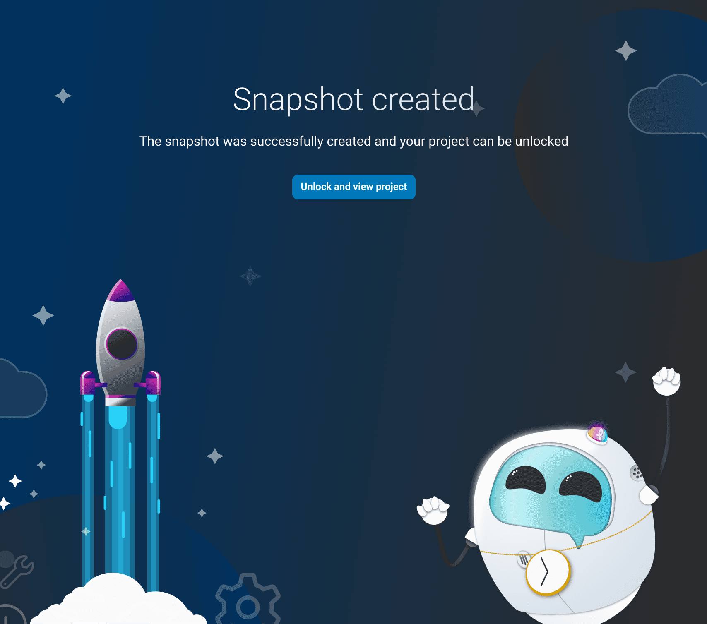

**Workstreams:**  
The versioning feature was designed as the foundation for a larger initiative I was developing in parallel: Workstreams. The concept brought branching to Mix, allowing users or teams to develop independently in their own workstream and merge back into the main project through a structured review and approval process. In practice it was a visual Git, with side-by-side diff views highlighting changes between states and a merge and approval flow built for non-technical users. Workstreams was still in progress when the project was paused, but it represented a natural and already-scoped next chapter for the feature.

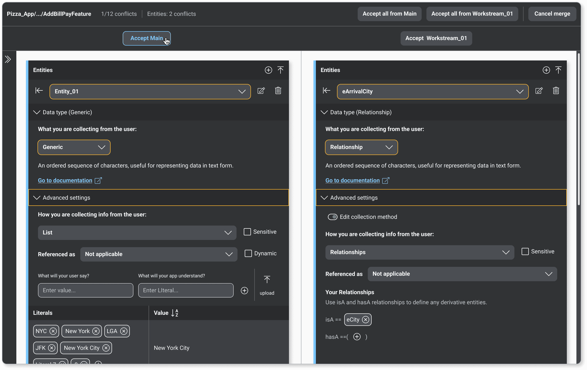

## Results

By the time platform investment was paused following Nuance's acquisition by Microsoft, the design was complete and implementation was underway, the result of a process I drove from ambiguous customer request to high-fidelity, developer-ready specs. The engineering team had begun building when the project was wound down.

The designs were validated internally and reflected months of iteration against real customer needs. The rollback model, timeline interface, and plain-language approach were well-received in internal reviews, and the Workstreams concept represented a clear and logical next step that would have significantly expanded Mix's capabilities for enterprise teams managing complex, multi-contributor projects.

The feature did not reach production, but the problem it was solving was real, the approach was validated, and the work represents one of the most complex systems challenges I have taken on: making version control feel effortless for users who had never needed to think about it before.

<Gallery>

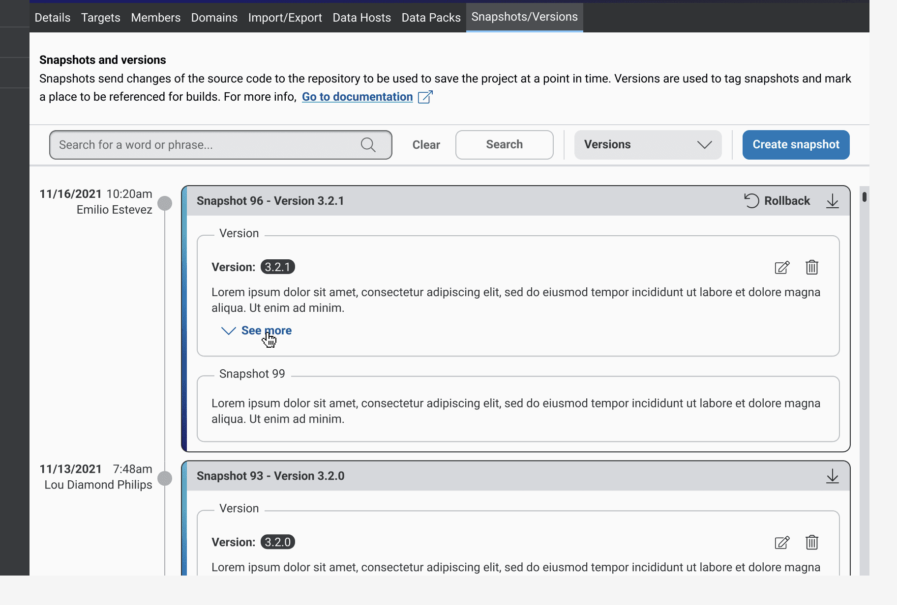
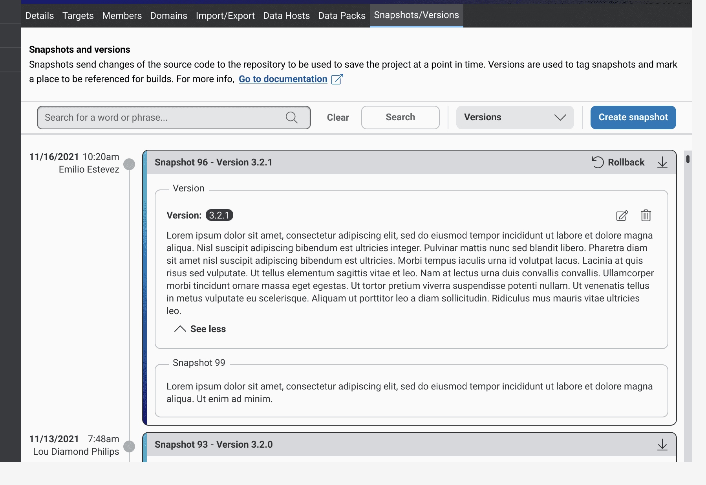

</Gallery>

## Conclusion

Versioning for Mix taught me a lot about designing at the edge of a user's mental model. The hardest part was not the interaction design. It was figuring out how to take a concept deeply embedded in technical culture and strip away everything that made it feel technical, while keeping everything that made it useful.

The timeline model was the right call. The Workstreams concept remains one of the ideas I am most proud of developing, even without a shipped product to point to. It pushed me to think about how visual diff, merge, and branch metaphors translate to a non-code environment, and it is a problem space I would be genuinely excited to return to.

This project also reinforced something I believe about enterprise product design: the complexity of the system is your problem, not the user's. Your job is to absorb it.

<Quote by="Principal Engineer, Nuance Mix" context="Stakeholder reaction in design review">
  I don't think I've ever seen branching and visual diffing done this way before. This is awesome.
</Quote>
