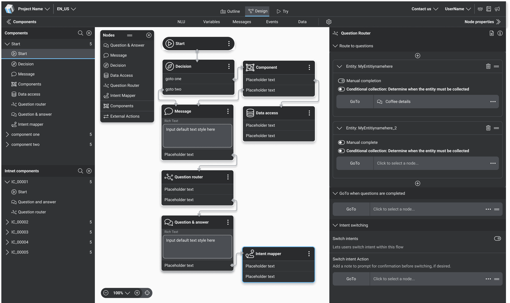
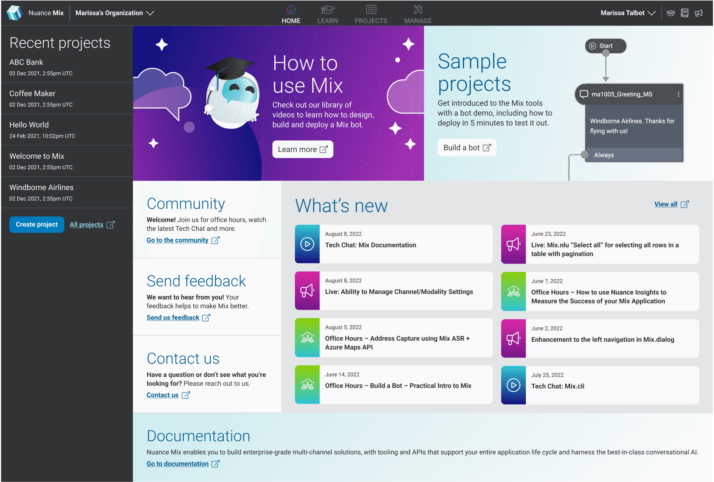
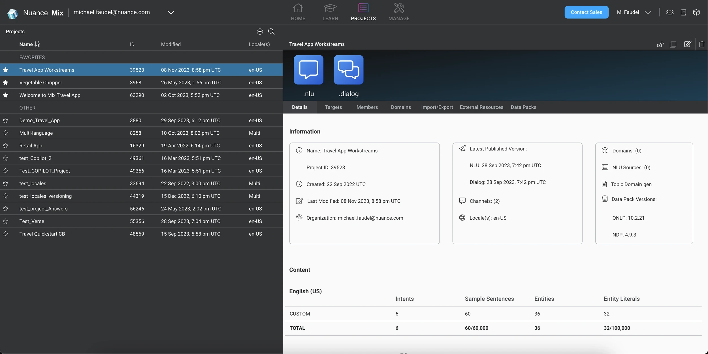
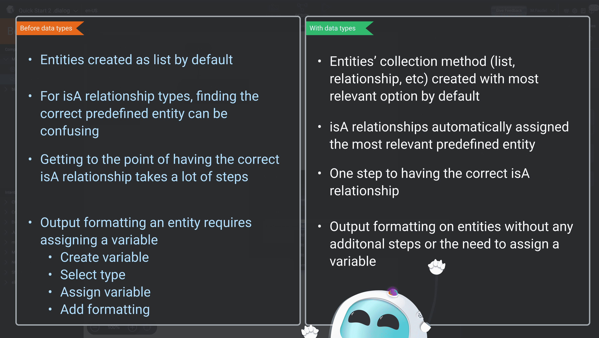
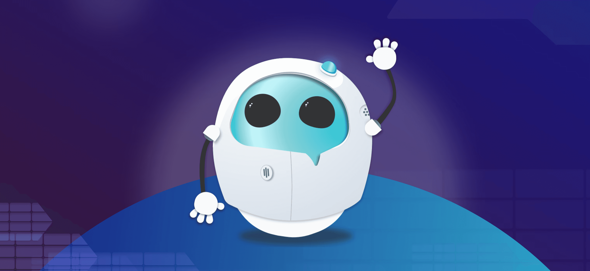
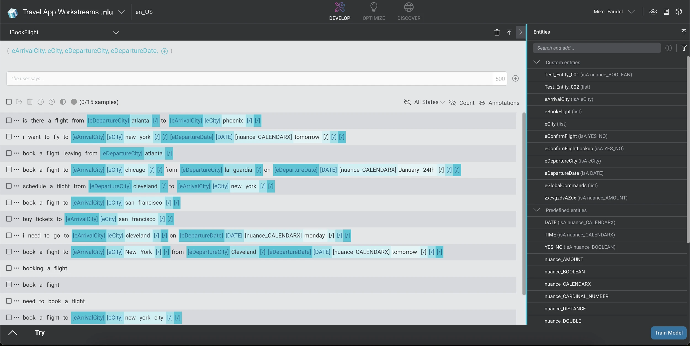

import Stats from "../../components/content/Stats.astro";
import Facts from "../../components/content/Facts.astro";
import Gallery from "../../components/content/Gallery.astro";
import Quote from "../../components/content/Quote.astro";
import LogoGrid from "../../components/content/LogoGrid.astro";

Nuance Mix is an enterprise conversational AI platform built on speech and NLU technology trusted by 1,500+ leading brands, including 75% of the Fortune 100, across healthcare, retail, and customer service.

I spent three years as a product designer on the Mix team, working across all three of the platform's core tools: NLU, Dialog, and Dashboard. The team operated collaboratively with no strict feature ownership boundaries, which meant every designer needed to develop working knowledge of the full product. I contributed to features across the entire platform, with my deepest work in Dialog and NLU.

<Facts
  title="About Nuance Mix"
  items={[
    { label: "Headquarters", value: "Burlington, MA" },
    { label: "Founded", value: "2015 (Nuance Communications: 1996)" },
    {
      label: "Deployment model",
      value: "SaaS platform with options for cloud or on‑prem/private‑hosted deployments",
    },
    { label: "Revenue", value: "$1.33 billion (2021)" },
    { label: "Company size", value: "6,900" },
  ]}
/>

## The product

Mix is built around three interconnected tools that work together to enable sophisticated conversational experiences.

**NLU (Natural Language Understanding)** is responsible for analyzing and interpreting user inputs, deciphering what a user is saying, identifying their intent, and extracting relevant entities and parameters.

**Dialog** controls the flow of conversation, orchestrating the exchange of messages between users and the virtual assistant. Via a node-based authoring canvas, users manage prompts, responses, context, and branching logic across multi-turn conversations.

**Dashboard** serves as the administrative hub: the home for project creation, sharing and publishing, analytics, channel management, and security settings.

As a designer on this product, I needed fluency across all three tools regardless of which feature I was working on. A change in NLU had implications for Dialog. A publishing flow lived in Dashboard but touched decisions made in both other tools. Understanding the full system was not optional.

<Stats
  items={[
    { value: "75%", label: "of the Fortune 100 trust Nuance’s core speech and NLU technology" },
    { value: "40+", label: "languages supported in a single Mix project" },
    { value: "1.5k +", label: "leading brands trust Nuance’s core speech and NLU technology" },
  ]}
/>

## Challenge

Mix was a powerful platform serving a technically demanding user base, but power and clarity do not always come together by default. Enterprise customers were building sophisticated conversational experiences on top of complex NLP and voice capabilities, and the product needed to make that complexity as approachable as possible without sacrificing depth.

The challenges showed up differently across the product. In some areas, multi-step workflows that could be simplified were creating unnecessary friction for both technical and non-technical users. In others, the relationship between concepts was not clearly communicated, leaving users guessing at the right approach. Customer feedback was a consistent driver of what the team worked on, and translating that feedback into design solutions that worked within the technical constraints of the platform was the core challenge of the role.

## Process

**Working across the full platform**  
Because ownership was shared across the team, every designer at Nuance needed to build genuine expertise in the product rather than relying on a narrow specialty. For me, coming from a background without deep technical experience in NLP or voice, this meant investing heavily in learning before designing. Understanding what I was building was not something I could shortcut, and that discipline of learning the domain first became a habit I have carried into every product I have worked on since.

I worked closely with engineering and product throughout, in a team culture that was genuinely collaborative, senior, and high-performing. Designers were expected to understand the technical constraints of what they were proposing, not just hand off screens and move on.

Research was embedded in our process through a dedicated researcher on the team. We initiated studies when we needed background understanding or validation, ran usability testing at key stages of design, and used customer feedback signals consistently to prioritize and shape the work.

## Feature work

### Data types

One of the most significant features I owned end to end was Data Types, which addressed a pain point that had been flagged consistently by customers. Before this feature, formatting the output of an entity required a multi-step process: create a variable, select a type, assign the variable, and add formatting. Each of those steps introduced opportunities for confusion and error, particularly for users who were not deeply technical.

The goal was to collapse that complexity into something dramatically simpler. The feature I designed allowed entities' collection methods and output formatting to be set automatically based on the most relevant defaults, reducing what had previously been a four-step process to a single step for the most common use cases.

Because the concepts involved were genuinely new to me, this feature required more upfront learning than most. I spent significant time with engineering partners understanding the underlying data model before I could confidently design for it. That investment paid off in the iteration process, where having a real understanding of the technical constraints meant I could explore more directions and make better decisions about which ones were actually feasible.

### Slot types

I also led a full redesign of slot types, adding the ability for users to change the collection method for entities. This was a cross-tool feature, with implications for both Dialog and NLU, and required coordination across the product to ensure the change felt consistent and logical regardless of where a user encountered it.

### Design system

Alongside feature work, I contributed heavily to the creation of Verse, the Mix design system, which was built from scratch during my time on the team. This was a collaborative effort across the design team that gave the product a consistent visual and interaction language and accelerated design and development work across all three tools.

### Max

One of the more distinctive contributions I made during my time at Nuance was designing Max, the Mix product mascot. In response to a design challenge from our manager, I created a robot character that won unanimous approval from the team and rolled out platform-wide, appearing in banners, the home screen, and loading states across the product. The work included multiple poses and moods to cover the range of contexts Max would appear in, along with a usage guide defining how and when the character could be used. In a product as technically dense as Mix, Max gave the platform a personality that users could connect with.

## Results

What shipped and what it changed:

- Data Types: cut formatting an entity’s output from four steps to one for the most common use cases.

- Slot types: redesigned across Dialog and NLU, so users can change an entity’s collection method with a consistent experience in both tools.

- Verse: co-built the Mix design system from scratch with the design team, giving all three tools one visual and interaction language.

- Max: designed the Mix mascot, which rolled out platform-wide in banners, the home screen and loading states, with multiple poses and moods and a usage guide.

What didn’t ship: Versioning and Workstreams reached developer-ready specs and early build before the project paused after the Microsoft acquisition. It has its own case study.

## Conclusion

Nuance is where I learned what it actually means to design enterprise software. Not in the abstract, but in practice: working with demanding engineers and product managers, designing for customers with serious technical requirements, and learning to hold my own in rooms full of people who knew the domain far better than I did when I walked in.

The team I worked with at Nuance set a standard I have tried to carry forward. It was collaborative, communicative, and genuinely invested in doing good work together. That kind of team culture is not an accident and I learned a lot about what makes one work by being part of it.

What I took most directly into my Microsoft work was the discipline of understanding before designing. At Nuance I learned that the best design decisions come from genuine product knowledge, not just UX pattern knowledge. That lesson has shaped how I approach every new area I have owned at Copilot Studio.
